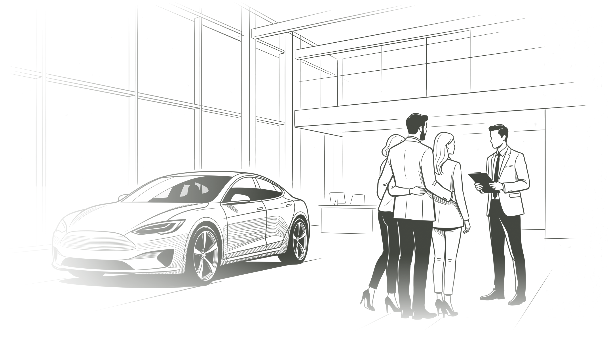
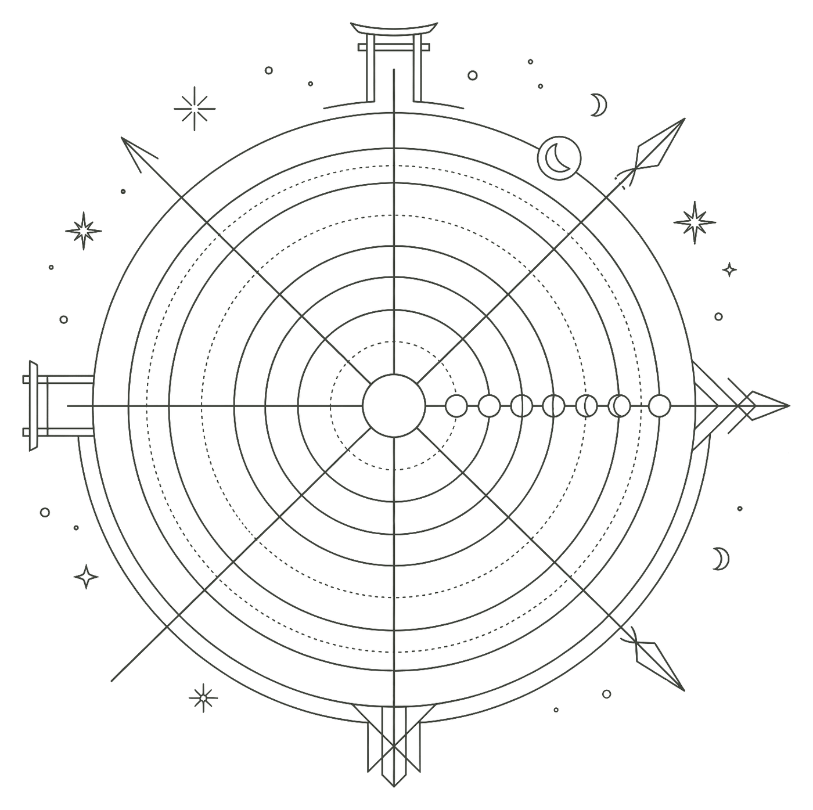

# Proposta First Line × Unioo — v6 (código-fonte completo)

> **Ver a proposta online (com imagens e fontes):** https://proposta-first-line-unioo.vercel.app
>
> **Este arquivo .md online:** https://proposta-first-line-unioo.vercel.app/proposta-first-line-e-unioo-v6-codigo.md
>
> **Contato:** Marcelo Gomes · WhatsApp (18) 99749-0298 · marcelogomes@unioo.online

Arquivo original: `proposta-first-line-e-unioo-v6.html`

Assets referenciados (caminhos relativos): `favicon.svg`, `hero-sketch.png`, `abordagem-sketch.png`, `images/marcelo-gomes.jpeg`, `fonts/InterTight-Variable.ttf`. Eles não estão embutidos neste .md — para a versão completa, use o link acima.

````html
<!DOCTYPE html>
<html lang="pt-BR">
<head>
  <meta charset="UTF-8" />
  <meta name="viewport" content="width=device-width, initial-scale=1.0" />
  <title>First Line e Unioo · Proposta de Aquisição Digital (Outubro 2026)</title>
  <meta name="robots" content="noindex, nofollow" />
  <link rel="icon" type="image/svg+xml" href="./favicon.svg" />

  <link rel="preconnect" href="https://fonts.googleapis.com">
  <link rel="preconnect" href="https://fonts.gstatic.com" crossorigin>
  <link href="https://fonts.googleapis.com/css2?family=Inter:wght@400;500;600&family=Inter+Tight:wght@300;400;500;600&display=swap" rel="stylesheet">

  <style>
    /* ==========================================================================
       FONTE INTER TIGHT (FALLBACK LOCAL)
       ========================================================================== */
    @font-face {
      font-family: 'Inter Tight';
      font-weight: 100 900;
      font-style: normal;
      font-display: swap;
      src: local('Inter Tight'), local('InterTight'),
           url('./fonts/InterTight-Variable.ttf') format('truetype-variations'),
           url('./fonts/InterTight-Variable.ttf') format('truetype');
    }

    /* ==========================================================================
       VARIÁVEIS DE DESIGN SYSTEM (PALETA VERDE UNIOO)
       ========================================================================== */
    :root {
      --unioo-green: #414F2F;
      --unioo-green-dark: #303B22;
      --unioo-green-light: #A7BD7E;
      --unioo-green-soft: #DDE5CF;

      --bg-page: #FAFBFA;
      --bg-card: #FFFFFF;
      --bg-card-soft: #F5F6F3;

      --text-primary: #1A1E16;
      --text-secondary: #555A4E;
      --text-muted: #6B7163;

      --border-subtle: #E6E8E2;
      --border-light: #DCDFD6;

      --font-display: 'Inter Tight', -apple-system, BlinkMacSystemFont, 'SF Pro Display', sans-serif;
      --font-body: 'Inter', -apple-system, BlinkMacSystemFont, 'SF Pro Text', sans-serif;

      --radius-card: 24px;
      --radius-banner: 32px;
      --radius-pill: 999px;

      --shadow-apple: 0 4px 20px -2px rgba(65, 79, 47, 0.06);
      --ease-apple: cubic-bezier(0.28, 0.11, 0.32, 1);
      --ease-out-expo: cubic-bezier(0.16, 1, 0.3, 1);
    }

    /* ==========================================================================
       RESET E BASE
       ========================================================================== */
    *, *::before, *::after {
      box-sizing: border-box;
      margin: 0;
      padding: 0;
    }

    html {
      scroll-behavior: smooth;
      scroll-padding-top: 72px;
      font-size: 16px;
      background-color: var(--bg-page);
      color: var(--text-primary);
    }

    body {
      font-family: var(--font-body);
      line-height: 1.6;
      background-color: var(--bg-page);
      color: var(--text-primary);
      -webkit-font-smoothing: antialiased;
      -moz-osx-font-smoothing: grayscale;
      overflow-x: hidden;
      text-rendering: optimizeLegibility;
    }

    a:focus-visible {
      outline: 2px solid var(--unioo-green);
      outline-offset: 3px;
      border-radius: 6px;
    }

    /* ==========================================================================
       PROGRESS BAR SUPERIOR
       ========================================================================== */
    #reading-progress {
      position: fixed;
      top: 0;
      left: 0;
      height: 3px;
      background: var(--unioo-green);
      width: 0%;
      z-index: 1000;
      transition: width 0.1s linear;
    }

    /* ==========================================================================
       NAVBAR (STICKY GLASSMORPHISM)
       ========================================================================== */
    .navbar {
      position: sticky;
      top: 0;
      z-index: 100;
      background: rgba(250, 251, 250, 0.88);
      backdrop-filter: saturate(180%) blur(20px);
      -webkit-backdrop-filter: saturate(180%) blur(20px);
      border-bottom: 1px solid rgba(228, 231, 223, 0.85);
    }

    .container {
      max-width: 1080px;
      margin: 0 auto;
      padding: 0 32px;
    }

    .navbar-inner {
      display: flex;
      align-items: center;
      justify-content: space-between;
      height: 64px;
    }

    .brand {
      display: inline-flex;
      align-items: center;
      gap: 12px;
      text-decoration: none;
      color: var(--text-primary);
    }

    .brand-logo {
      height: 20px;
      width: auto;
      display: block;
    }

    .brand-divider {
      width: 1px;
      height: 18px;
      background: var(--border-light);
    }

    .brand-client {
      font-family: var(--font-display);
      font-size: 15px;
      font-weight: 500;
      letter-spacing: -0.02em;
    }

    .brand-date {
      color: var(--text-muted);
      font-weight: 400;
      font-size: 13px;
      margin-left: 2px;
    }

    .nav-links {
      display: flex;
      align-items: center;
      gap: 26px;
      list-style: none;
    }

    .nav-links a {
      font-size: 13.5px;
      font-weight: 500;
      color: var(--text-secondary);
      text-decoration: none;
      transition: color 0.2s ease;
    }

    .nav-links a:hover {
      color: var(--unioo-green);
    }

    .nav-links .btn-nav {
      background: var(--unioo-green);
      color: #ffffff;
      font-size: 12.5px;
      padding: 8px 18px;
      border-radius: var(--radius-pill);
      transition: all 0.2s var(--ease-apple);
      box-shadow: 0 4px 12px rgba(65, 79, 47, 0.15);
    }

    .nav-links .btn-nav:hover {
      background: var(--unioo-green-dark);
      color: #ffffff;
    }

    /* ==========================================================================
       HERO
       ========================================================================== */
    .hero {
      position: relative;
      padding: 104px 0 110px;
      min-height: clamp(620px, 82vh, 880px);
      display: flex;
      align-items: center;
      background: radial-gradient(ellipse at 25% 25%, rgba(167, 189, 126, 0.22) 0%, rgba(250, 251, 250, 0) 70%);
      overflow: hidden;
    }

    .hero-illustration {
      position: absolute;
      top: 0;
      right: -2%;
      bottom: 0;
      width: 62%;
      pointer-events: none;
      z-index: 1;
      display: flex;
      align-items: flex-end;
      justify-content: flex-end;
    }

    .hero-illustration img {
      width: 100%;
      height: 100%;
      object-fit: contain;
      object-position: right bottom;
      mix-blend-mode: multiply;
      opacity: 0.95;
    }

    .hero-container {
      position: relative;
      z-index: 2;
      width: 100%;
    }

    .hero-content {
      max-width: 820px;
    }

    .hero-content .lead-paragraph {
      max-width: 50ch;
    }

    .pill-badge-unioo {
      display: inline-flex;
      align-items: center;
      gap: 8px;
      padding: 6px 16px;
      border-radius: var(--radius-pill);
      background: #ffffff;
      border: 1px solid var(--border-light);
      box-shadow: 0 2px 10px rgba(65, 79, 47, 0.05);
      font-size: 13px;
      font-weight: 500;
      letter-spacing: -0.01em;
      color: var(--unioo-green);
    }

    .pill-badge-unioo .dot {
      width: 6px;
      height: 6px;
      border-radius: 50%;
      background: var(--unioo-green-light);
    }

    .hero-title {
      font-family: var(--font-display);
      font-weight: 300;
      font-size: clamp(42px, 5.2vw, 76px);
      line-height: 1.04;
      letter-spacing: -0.035em;
      color: var(--text-primary);
      margin: 26px 0 24px;
    }

    .lead-paragraph {
      font-size: clamp(17px, 1.6vw, 20px);
      line-height: 1.55;
      letter-spacing: -0.012em;
      color: var(--text-secondary);
      max-width: 60ch;
      text-wrap: pretty;
    }

    .hero-actions {
      display: flex;
      align-items: center;
      gap: 12px;
      margin-top: 36px;
      flex-wrap: wrap;
    }

    .btn-primary,
    .btn-secondary {
      display: inline-flex;
      align-items: center;
      justify-content: center;
      gap: 8px;
      font-size: 14.5px;
      font-weight: 500;
      padding: 13px 26px;
      border-radius: var(--radius-pill);
      text-decoration: none;
      transition: all 0.25s var(--ease-apple);
    }

    .btn-primary {
      background-color: var(--unioo-green);
      color: #ffffff;
      box-shadow: 0 4px 14px rgba(65, 79, 47, 0.2);
    }

    .btn-primary:hover {
      background-color: var(--unioo-green-dark);
      transform: translateY(-2px);
      box-shadow: 0 8px 22px rgba(65, 79, 47, 0.3);
    }

    .btn-secondary {
      background-color: #ffffff;
      color: var(--text-primary);
      border: 1px solid var(--border-light);
    }

    .btn-secondary:hover {
      border-color: #c9cebf;
      transform: translateY(-2px);
    }

    /* ==========================================================================
       ESTRUTURA GERAL DE SEÇÕES
       ========================================================================== */
    section {
      padding: 96px 0;
      border-bottom: 1px solid var(--border-subtle);
    }

    section.tinted {
      background: var(--bg-card-soft);
    }

    .grid-2col {
      display: grid;
      grid-template-columns: 1fr 1.6fr;
      gap: 64px;
    }

    .eyebrow {
      font-size: 12px;
      font-weight: 600;
      text-transform: uppercase;
      letter-spacing: 0.08em;
      color: var(--text-muted);
      display: block;
    }

    .section-title {
      font-family: var(--font-display);
      font-weight: 400;
      font-size: clamp(30px, 4.2vw, 48px);
      line-height: 1.08;
      letter-spacing: -0.03em;
      color: var(--text-primary);
      margin-top: 14px;
      max-width: 22ch;
      text-wrap: balance;
    }

    .section-head .lead-paragraph {
      margin-top: 18px;
    }

    /* ==========================================================================
       01 · CONTEXTO
       ========================================================================== */
    .context-list {
      margin-top: 40px;
      display: flex;
      flex-direction: column;
      gap: 24px;
    }

    .context-item {
      display: grid;
      grid-template-columns: 32px 1fr;
      gap: 4px 12px;
      padding-bottom: 24px;
      border-bottom: 1px solid var(--border-subtle);
    }

    .context-item:last-child {
      border-bottom: none;
      padding-bottom: 0;
    }

    .context-item .idx {
      font-family: var(--font-display);
      font-size: 13px;
      font-weight: 600;
      color: var(--unioo-green);
      padding-top: 3px;
    }

    .context-item h3 {
      font-family: var(--font-display);
      font-size: 18px;
      font-weight: 600;
      letter-spacing: -0.018em;
      color: var(--text-primary);
    }

    .context-item p {
      grid-column: 2;
      font-size: 14.5px;
      line-height: 1.55;
      color: var(--text-secondary);
    }

    /* ==========================================================================
       02 · OBJETIVOS
       ========================================================================== */
    .cards-grid-4 {
      display: grid;
      grid-template-columns: repeat(4, 1fr);
      gap: 18px;
      margin-top: 48px;
    }

    .apple-card {
      background-color: var(--bg-card);
      border: 1px solid var(--border-subtle);
      border-radius: var(--radius-card);
      padding: 30px 26px;
      display: flex;
      flex-direction: column;
      min-height: 250px;
    }

    .card-num {
      font-family: var(--font-display);
      font-size: 13px;
      font-weight: 600;
      color: var(--unioo-green);
      padding-bottom: 36px;
    }

    .apple-card h3 {
      font-family: var(--font-display);
      font-size: 18px;
      font-weight: 600;
      letter-spacing: -0.02em;
      color: var(--text-primary);
      margin-bottom: 8px;
    }

    .apple-card p {
      font-size: 14px;
      line-height: 1.55;
      color: var(--text-secondary);
    }

    /* ==========================================================================
       03 · ABORDAGEM (LINHA DO TEMPO DA FASE 1 + DIVISÃO DE VERBA)
       ========================================================================== */
    #abordagem {
      position: relative;
      overflow: hidden;
    }

    .abordagem-illustration {
      position: absolute;
      top: 50%;
      left: -20%;
      width: min(54%, 780px);
      aspect-ratio: 1;
      transform: translateY(-50%);
      pointer-events: none;
      z-index: 0;
    }

    .abordagem-illustration img {
      width: 100%;
      height: 100%;
      object-fit: contain;
      object-position: left center;
      mix-blend-mode: multiply;
      opacity: 0.26;
      -webkit-mask-image: linear-gradient(to right, #000 45%, transparent 92%);
      mask-image: linear-gradient(to right, #000 45%, transparent 92%);
    }

    #abordagem > .container {
      position: relative;
      z-index: 1;
    }

    .timeline {
      list-style: none;
      position: relative;
      display: flex;
      flex-direction: column;
    }

    .timeline::before {
      content: "";
      position: absolute;
      left: 11px;
      top: 12px;
      bottom: 12px;
      width: 2px;
      background: linear-gradient(var(--unioo-green), var(--unioo-green-soft));
    }

    .timeline-step {
      position: relative;
      display: grid;
      grid-template-columns: 24px 1fr;
      gap: 0 20px;
      padding-bottom: 28px;
    }

    .timeline-step:last-child {
      padding-bottom: 0;
    }

    .timeline-dot {
      width: 24px;
      height: 24px;
      border-radius: 50%;
      background: var(--bg-page);
      border: 2px solid var(--unioo-green);
      position: relative;
      z-index: 1;
    }

    .timeline-step:first-child .timeline-dot {
      background: var(--unioo-green);
      box-shadow: 0 0 0 5px rgba(65, 79, 47, 0.12);
    }

    .timeline-when {
      font-size: 12px;
      font-weight: 600;
      text-transform: uppercase;
      letter-spacing: 0.06em;
      color: var(--unioo-green);
      line-height: 24px;
    }

    .timeline-body {
      grid-column: 2;
      background: var(--bg-card);
      border: 1px solid var(--border-subtle);
      border-radius: 18px;
      padding: 18px 22px;
      margin-top: 8px;
    }

    .timeline-body h4 {
      font-family: var(--font-display);
      font-size: 17px;
      font-weight: 600;
      letter-spacing: -0.015em;
      margin-bottom: 4px;
    }

    .timeline-body p {
      font-size: 14px;
      line-height: 1.5;
      color: var(--text-secondary);
    }

    .timeline-tags {
      display: flex;
      flex-wrap: wrap;
      gap: 6px;
      margin-top: 12px;
    }

    .chip {
      font-size: 12px;
      font-weight: 500;
      color: var(--text-secondary);
      background: var(--bg-card-soft);
      padding: 3px 10px;
      border-radius: var(--radius-pill);
      border: 1px solid var(--border-subtle);
    }

    .budget-card {
      margin-top: 32px;
      background: var(--bg-card);
      border: 1px solid var(--border-subtle);
      border-radius: var(--radius-card);
      padding: 26px 24px;
    }

    .budget-head {
      display: flex;
      justify-content: space-between;
      align-items: baseline;
      margin-bottom: 16px;
      gap: 12px;
    }

    .budget-head .label {
      font-size: 13px;
      font-weight: 600;
      color: var(--text-primary);
    }

    .budget-head .total {
      font-family: var(--font-display);
      font-size: 22px;
      font-weight: 600;
      letter-spacing: -0.02em;
    }

    .budget-bar {
      display: flex;
      height: 12px;
      border-radius: var(--radius-pill);
      overflow: hidden;
      gap: 3px;
    }

    .budget-bar .meta {
      flex: 60;
      background: var(--unioo-green);
    }

    .budget-bar .google {
      flex: 40;
      background: var(--unioo-green-light);
    }

    .budget-legend {
      display: grid;
      grid-template-columns: 1fr 1fr;
      gap: 12px;
      margin-top: 14px;
    }

    .budget-legend strong {
      display: flex;
      align-items: center;
      gap: 8px;
      font-size: 13.5px;
      font-weight: 600;
      color: var(--text-primary);
    }

    .budget-legend strong::before {
      content: "";
      width: 8px;
      height: 8px;
      border-radius: 2px;
      background: var(--unioo-green);
    }

    .budget-legend div:last-child strong::before {
      background: var(--unioo-green-light);
    }

    .budget-legend span {
      display: block;
      font-size: 12.5px;
      color: var(--text-muted);
      margin-top: 2px;
      padding-left: 16px;
    }

    .budget-note {
      font-size: 12.5px;
      color: var(--text-muted);
      margin-top: 14px;
      padding-top: 14px;
      border-top: 1px solid var(--border-subtle);
    }

    /* ==========================================================================
       04 · QUEM CONDUZ (CARD AUTORAL)
       ========================================================================== */
    .author-card {
      margin-top: 48px;
      display: grid;
      grid-template-columns: 300px 1fr;
      background: var(--bg-card);
      border: 1px solid var(--border-subtle);
      border-radius: var(--radius-card);
      overflow: hidden;
      box-shadow: var(--shadow-apple);
    }

    .author-portrait {
      position: relative;
      isolation: isolate;
      overflow: hidden;
      background: #252b20;
      color: #ffffff;
      padding: 36px 32px;
      display: flex;
      flex-direction: column;
      justify-content: flex-end;
      min-height: 420px;
    }

    .author-portrait::after {
      content: '';
      position: absolute;
      inset: 0;
      z-index: 1;
      pointer-events: none;
      background: linear-gradient(180deg, transparent 45%, rgba(23, 28, 20, 0.18) 60%, rgba(23, 28, 20, 0.88) 84%, #171c14 100%);
    }

    .author-photo {
      position: absolute;
      inset: 0;
      width: 100%;
      height: 100%;
      display: block;
      object-fit: cover;
      object-position: 59% 25%;
      filter: grayscale(100%);
    }

    .author-identity {
      position: relative;
      z-index: 2;
    }

    .author-portrait h3 {
      font-family: var(--font-display);
      font-size: 26px;
      font-weight: 500;
      letter-spacing: -0.025em;
      margin-bottom: 4px;
    }

    .author-portrait .role {
      font-size: 13.5px;
      color: #d1d8c8;
    }

    .author-body {
      padding: 36px 40px;
    }

    .author-quote {
      font-family: var(--font-display);
      font-size: 22px;
      font-weight: 400;
      line-height: 1.35;
      letter-spacing: -0.02em;
      color: var(--text-primary);
      max-width: 34ch;
    }

    .author-bio {
      font-size: 14.5px;
      line-height: 1.6;
      color: var(--text-secondary);
      margin-top: 16px;
      max-width: 62ch;
    }

    .author-brands {
      display: flex;
      flex-wrap: wrap;
      gap: 8px;
      margin-top: 18px;
    }

    .author-skills {
      display: grid;
      grid-template-columns: repeat(3, 1fr);
      gap: 0;
      margin-top: 28px;
      border-top: 1px solid var(--border-subtle);
    }

    .author-skill {
      padding: 20px 20px 0 0;
    }

    .author-skill + .author-skill {
      padding-left: 20px;
      border-left: 1px solid var(--border-subtle);
    }

    .author-skill .tag {
      font-size: 11px;
      font-weight: 600;
      text-transform: uppercase;
      letter-spacing: 0.06em;
      color: var(--unioo-green);
    }

    .author-skill p {
      font-size: 13.5px;
      line-height: 1.5;
      color: var(--text-secondary);
      margin-top: 6px;
    }

    /* ==========================================================================
       05 · ESCOPO & ENTREGÁVEIS
       ========================================================================== */
    .scope-blocks {
      display: flex;
      flex-direction: column;
      gap: 12px;
      margin-top: 28px;
    }

    .scope-block {
      background: #ffffff;
      border: 1px solid var(--border-subtle);
      border-radius: 16px;
      padding: 16px 20px;
    }

    .scope-block.out {
      background: transparent;
      border-style: dashed;
      border-color: var(--border-light);
    }

    .scope-block h4 {
      font-size: 14px;
      font-weight: 600;
      color: var(--text-primary);
      margin-bottom: 2px;
    }

    .scope-block p {
      font-size: 13.5px;
      color: var(--text-secondary);
      line-height: 1.5;
    }

    .deliverables-card {
      background: #ffffff;
      border: 1px solid var(--border-subtle);
      border-radius: var(--radius-card);
      padding: 38px 36px;
      box-shadow: var(--shadow-apple);
    }

    .deliverables-card h3 {
      font-family: var(--font-display);
      font-size: 22px;
      font-weight: 600;
      letter-spacing: -0.02em;
      margin-bottom: 24px;
    }

    .deliverable-phase + .deliverable-phase {
      margin-top: 26px;
      padding-top: 24px;
      border-top: 1px solid var(--border-subtle);
    }

    .deliverable-phase-title {
      font-size: 12px;
      font-weight: 600;
      text-transform: uppercase;
      letter-spacing: 0.06em;
      color: var(--unioo-green);
      margin-bottom: 12px;
    }

    .deliverables-list {
      list-style: none;
      display: flex;
      flex-direction: column;
      gap: 10px;
    }

    .deliverables-list li {
      font-size: 14px;
      color: var(--text-secondary);
      line-height: 1.5;
      display: flex;
      align-items: flex-start;
      gap: 12px;
    }

    .deliverables-list li svg {
      flex-shrink: 0;
      margin-top: 3px;
      color: var(--unioo-green);
    }

    /* ==========================================================================
       06 · INVESTIMENTO
       ========================================================================== */
    .investment-card {
      background: #ffffff;
      border: 1px solid var(--border-subtle);
      border-radius: var(--radius-card);
      padding: 34px 32px;
      box-shadow: var(--shadow-apple);
      margin-top: 32px;
    }

    .fee-badge {
      display: inline-block;
      font-size: 11.5px;
      font-weight: 600;
      text-transform: uppercase;
      letter-spacing: 0.05em;
      color: var(--unioo-green);
      background: rgba(65, 79, 47, 0.08);
      padding: 4px 12px;
      border-radius: var(--radius-pill);
      margin-bottom: 18px;
    }

    .fee-amount {
      font-family: var(--font-display);
      font-size: 44px;
      font-weight: 600;
      letter-spacing: -0.03em;
      line-height: 1.1;
      margin-bottom: 6px;
    }

    .fee-period {
      font-size: 14.5px;
      color: var(--text-secondary);
      margin-bottom: 20px;
    }

    .fee-summary {
      border-top: 1px solid var(--border-subtle);
      padding-top: 18px;
      display: flex;
      flex-direction: column;
      gap: 10px;
    }

    .fee-row {
      display: flex;
      justify-content: space-between;
      gap: 12px;
      font-size: 13.5px;
      color: var(--text-secondary);
    }

    .fee-row strong {
      color: var(--text-primary);
      text-align: right;
    }

    .payment-flow-card {
      background: #ffffff;
      border: 1px solid var(--border-subtle);
      border-radius: var(--radius-card);
      padding: 36px 32px;
      box-shadow: var(--shadow-apple);
    }

    .payment-flow-card h3 {
      font-family: var(--font-display);
      font-size: 20px;
      font-weight: 600;
      letter-spacing: -0.02em;
      margin-bottom: 6px;
    }

    .payment-flow-card > p {
      font-size: 14px;
      color: var(--text-secondary);
      margin-bottom: 24px;
    }

    .pay-months {
      display: grid;
      grid-template-columns: repeat(3, 1fr);
      gap: 10px;
    }

    .pay-month {
      background: var(--bg-card-soft);
      border: 1px solid var(--border-subtle);
      border-radius: 16px;
      padding: 16px 16px 14px;
    }

    .pay-month.first {
      background: rgba(65, 79, 47, 0.06);
      border-color: rgba(65, 79, 47, 0.2);
    }

    .pay-month .m {
      font-size: 12px;
      font-weight: 600;
      text-transform: uppercase;
      letter-spacing: 0.06em;
      color: var(--text-muted);
    }

    .pay-month .v {
      display: block;
      font-family: var(--font-display);
      font-size: 22px;
      font-weight: 600;
      letter-spacing: -0.02em;
      color: var(--text-primary);
      margin: 4px 0 10px;
    }

    .pay-split {
      display: flex;
      flex-direction: column;
      gap: 4px;
      font-size: 12.5px;
      color: var(--text-secondary);
    }

    .pay-split div {
      display: flex;
      justify-content: space-between;
      gap: 8px;
    }

    .pay-total {
      display: flex;
      justify-content: space-between;
      align-items: baseline;
      margin: 18px 0 26px;
      padding: 14px 4px 0;
      border-top: 1px solid var(--border-subtle);
      font-size: 13.5px;
      color: var(--text-secondary);
    }

    .pay-total strong {
      font-family: var(--font-display);
      font-size: 18px;
      color: var(--unioo-green);
    }

    .payment-label {
      display: block;
      font-size: 11px;
      font-weight: 600;
      text-transform: uppercase;
      letter-spacing: 0.06em;
      color: var(--text-muted);
      margin-bottom: 12px;
    }

    .includes-list {
      list-style: none;
      display: flex;
      flex-direction: column;
      gap: 10px;
    }

    .includes-list li {
      font-size: 13.5px;
      color: var(--text-secondary);
      line-height: 1.5;
      padding-left: 18px;
      position: relative;
    }

    .includes-list li::before {
      content: "";
      position: absolute;
      left: 2px;
      top: 8px;
      width: 6px;
      height: 6px;
      border-radius: 50%;
      background: var(--unioo-green);
    }

    /* ==========================================================================
       07 · PRÓXIMAS FASES
       ========================================================================== */
    .gates {
      display: grid;
      grid-template-columns: repeat(3, 1fr);
      gap: 16px;
      margin-top: 44px;
    }

    .gate {
      background: var(--bg-card);
      border: 1px solid var(--border-subtle);
      border-radius: 20px;
      padding: 24px 24px 22px;
    }

    .gate .metric {
      font-family: var(--font-display);
      font-size: 40px;
      font-weight: 300;
      letter-spacing: -0.03em;
      line-height: 1;
      color: var(--unioo-green);
    }

    .gate h4 {
      font-size: 14px;
      font-weight: 600;
      margin-top: 14px;
    }

    .gate p {
      font-size: 13px;
      line-height: 1.5;
      color: var(--text-secondary);
      margin-top: 4px;
    }

    .gates-caption {
      font-size: 13px;
      color: var(--text-muted);
      margin-top: 14px;
    }

    .reserve-grid {
      display: grid;
      grid-template-columns: 1fr 1fr;
      gap: 20px;
      margin-top: 40px;
    }

    .reserve-card {
      background: #ffffff;
      border: 1px solid var(--border-subtle);
      border-radius: var(--radius-card);
      padding: 30px 28px;
      display: flex;
      flex-direction: column;
      justify-content: space-between;
    }

    .reserve-top {
      display: flex;
      justify-content: space-between;
      align-items: center;
      margin-bottom: 18px;
    }

    .tag-mini {
      font-size: 11px;
      font-weight: 600;
      text-transform: uppercase;
      letter-spacing: 0.06em;
      color: var(--unioo-green);
      background: #ffffff;
      padding: 5px 12px;
      border-radius: var(--radius-pill);
      border: 1px solid var(--border-light);
    }

    .reserve-top .when {
      font-size: 12px;
      color: var(--text-muted);
    }

    .reserve-card h3 {
      font-family: var(--font-display);
      font-size: 20px;
      font-weight: 600;
      letter-spacing: -0.02em;
      margin-bottom: 8px;
    }

    .reserve-card p {
      font-size: 14px;
      line-height: 1.55;
      color: var(--text-secondary);
    }

    .reserve-pills {
      display: flex;
      flex-wrap: wrap;
      gap: 8px;
      margin-top: 18px;
    }

    .reserve-footer {
      border-top: 1px solid var(--border-subtle);
      padding-top: 16px;
      margin-top: 24px;
      display: flex;
      justify-content: space-between;
      gap: 12px;
      font-size: 12.5px;
      color: var(--text-muted);
    }

    /* ==========================================================================
       PRÓXIMO PASSO (BANNER ESCURO)
       ========================================================================== */
    #proximo-passo {
      border-bottom: none;
    }

    .dark-banner {
      background: #171c14;
      border-radius: var(--radius-banner);
      padding: 64px 56px;
      color: #ffffff;
      box-shadow: 0 20px 50px rgba(23, 28, 20, 0.25);
    }

    .dark-banner .eyebrow {
      color: var(--unioo-green-light);
    }

    .dark-banner .section-title {
      color: #ffffff;
      margin-bottom: 18px;
    }

    .dark-banner .lead-paragraph {
      color: #b5bcad;
      margin-bottom: 38px;
    }

    .dark-steps {
      display: grid;
      grid-template-columns: repeat(3, 1fr);
      gap: 16px;
      counter-reset: step;
    }

    .dark-subcard {
      background: rgba(255, 255, 255, 0.05);
      border: 1px solid rgba(255, 255, 255, 0.1);
      border-radius: 20px;
      padding: 24px 22px;
    }

    .dark-subcard::before {
      counter-increment: step;
      content: "0" counter(step);
      display: block;
      font-family: var(--font-display);
      font-size: 13px;
      font-weight: 600;
      color: var(--unioo-green-light);
      margin-bottom: 18px;
    }

    .dark-subcard h4 {
      font-size: 16px;
      font-weight: 600;
      margin-bottom: 6px;
    }

    .dark-subcard p {
      font-size: 13.5px;
      color: #a3aba0;
      line-height: 1.5;
    }

    .dark-cta {
      display: flex;
      flex-wrap: wrap;
      align-items: center;
      justify-content: space-between;
      gap: 20px;
      margin-top: 40px;
      padding-top: 32px;
      border-top: 1px solid rgba(255, 255, 255, 0.1);
    }

    .dark-cta .actions {
      display: flex;
      flex-wrap: wrap;
      gap: 12px;
    }

    .dark-cta .btn-primary {
      background: var(--unioo-green-light);
      color: #171c14;
      box-shadow: none;
    }

    .dark-cta .btn-primary:hover {
      background: #b9cd93;
    }

    .dark-cta .btn-secondary {
      background: transparent;
      color: #ffffff;
      border-color: rgba(255, 255, 255, 0.22);
    }

    .dark-cta .btn-secondary:hover {
      border-color: rgba(255, 255, 255, 0.5);
    }

    .validity {
      font-size: 13px;
      color: #a3aba0;
    }

    .validity strong {
      color: #ffffff;
      font-weight: 500;
    }

    .contact-line {
      margin-top: 6px;
    }

    .contact-line a {
      color: #ffffff;
      text-decoration: none;
      border-bottom: 1px solid rgba(255, 255, 255, 0.22);
    }

    .contact-line a:hover {
      border-color: rgba(255, 255, 255, 0.6);
    }

    .footer-contact a {
      color: inherit;
      text-decoration: none;
    }

    .footer-contact a:hover {
      color: var(--text-primary, inherit);
    }

    /* ==========================================================================
       FOOTER
       ========================================================================== */
    footer {
      padding: 36px 0 44px;
      border-top: 1px solid var(--border-subtle);
    }

    .footer-inner {
      display: flex;
      justify-content: space-between;
      align-items: center;
      gap: 16px;
      font-size: 13px;
      color: var(--text-muted);
    }

    .footer-brand {
      display: flex;
      align-items: center;
      gap: 14px;
    }

    .footer-brand .brand-logo {
      height: 18px;
    }

    /* ==========================================================================
       MOTION (SCROLL SUAVE, REVEALS E EFEITOS LIGADOS AO SCROLL)
       Tudo fica atrás de .motion, que só é aplicada sem prefers-reduced-motion
       ========================================================================== */
    html.lenis, html.lenis body { height: auto; }
    .lenis.lenis-smooth { scroll-behavior: auto !important; }
    .lenis.lenis-stopped { overflow: hidden; }

    [data-count] { font-variant-numeric: tabular-nums; }

    .btn-primary:active,
    .btn-secondary:active,
    .nav-links .btn-nav:active {
      transform: scale(0.97);
    }

    /* Navbar transparente no topo, vidro fosco ao rolar */
    .navbar {
      transition: background 0.4s ease, border-color 0.4s ease, box-shadow 0.4s ease;
    }

    .motion .navbar:not(.is-scrolled) {
      background: rgba(250, 251, 250, 0);
      border-bottom-color: transparent;
      backdrop-filter: none;
      -webkit-backdrop-filter: none;
    }

    .navbar.is-scrolled {
      box-shadow: 0 8px 30px -14px rgba(23, 28, 20, 0.14);
    }

    /* Hero: título revelado por máscara, linha a linha */
    .hero-title .line {
      display: block;
      overflow: hidden;
      padding-bottom: 0.1em;
      margin-bottom: -0.1em;
    }

    .hero-title .line > span {
      display: block;
    }

    .motion .hero-title .line > span {
      transform: translateY(110%);
      animation: line-up 1.2s var(--ease-out-expo) 0.1s forwards;
    }

    .motion .hero-title .line + .line > span {
      animation-delay: 0.22s;
    }

    .motion .hero-intro {
      opacity: 0;
      transform: translateY(18px);
      animation: fade-up 1s var(--ease-out-expo) var(--d, 0s) forwards;
    }

    .motion .hero-illustration img {
      opacity: 0;
      transform: scale(1.06);
      animation: hero-art 1.8s var(--ease-out-expo) 0.25s forwards;
    }

    .motion .hero-content,
    .motion .hero-illustration {
      will-change: transform, opacity;
    }

    @keyframes line-up { to { transform: none; } }
    @keyframes fade-up { to { opacity: 1; transform: none; } }
    @keyframes hero-art { to { opacity: 0.95; transform: none; } }

    /* Reveal de bloco */
    .motion .reveal-on-scroll {
      opacity: 0;
      transform: translateY(40px);
      transition: opacity 1s var(--ease-out-expo), transform 1.2s var(--ease-out-expo);
    }

    .motion .reveal-on-scroll.is-visible {
      opacity: 1;
      transform: none;
    }

    /* Cascata de itens (cards, passos, indicadores) */
    .motion .stagger > * {
      opacity: 0;
      transform: translateY(28px) scale(0.98);
      filter: blur(6px);
      transition: opacity 0.9s var(--ease-out-expo), transform 1.1s var(--ease-out-expo), filter 0.9s var(--ease-out-expo);
      transition-delay: calc(var(--i, 0) * 90ms + 120ms);
    }

    .motion .stagger.is-visible > * {
      opacity: 1;
      transform: none;
      filter: none;
    }

    /* Texto que acende palavra a palavra conforme o scroll */
    .motion .scrub-text .w {
      opacity: 0.18;
      transition: opacity 0.35s linear;
    }

    .motion .scrub-text .w.on {
      opacity: 1;
    }

    /* Linha do tempo que se preenche com o scroll */
    .timeline::after {
      content: "";
      position: absolute;
      left: 11px;
      top: 12px;
      bottom: 12px;
      width: 2px;
      background: var(--unioo-green);
      transform-origin: top;
      display: none;
    }

    .motion .timeline::before {
      background: var(--border-light);
    }

    .motion .timeline::after {
      display: block;
      transform: scaleY(var(--p, 0));
    }

    .motion .timeline-dot {
      transition: background 0.4s ease, box-shadow 0.4s ease;
    }

    .motion .timeline-step.is-active .timeline-dot {
      background: var(--unioo-green);
      box-shadow: 0 0 0 5px rgba(65, 79, 47, 0.12);
    }

    /* Barra de verba que cresce ao entrar na tela */
    .motion .budget-bar span {
      transform: scaleX(0);
      transform-origin: left;
      transition: transform 1.4s var(--ease-out-expo) 0.3s;
    }

    .motion .budget-bar .google {
      transition-delay: 0.5s;
    }

    .motion .budget-card.is-visible .budget-bar span {
      transform: none;
    }

    /* Banner final que se expande ao entrar */
    .motion .dark-banner {
      transform: scale(var(--s, 1));
      transform-origin: center bottom;
      will-change: transform;
    }

    @media (prefers-reduced-motion: reduce) {
      html { scroll-behavior: auto; }
    }

    /* ==========================================================================
       RESPONSIVIDADE
       ========================================================================== */
    @media (max-width: 960px) {
      .hero {
        min-height: auto;
        padding: 84px 0 76px;
      }
      .hero-illustration {
        width: 80%;
        opacity: 0.45;
      }
      .abordagem-illustration {
        top: 0;
        left: -30%;
        width: 110%;
        transform: none;
      }
      .abordagem-illustration img {
        opacity: 0.18;
      }
      .grid-2col {
        grid-template-columns: 1fr;
        gap: 40px;
      }
      .cards-grid-4 {
        grid-template-columns: repeat(2, 1fr);
      }
      .author-card {
        grid-template-columns: 1fr;
      }
      .author-portrait {
        min-height: 360px;
        aspect-ratio: 2 / 1;
      }
      .reserve-grid,
      .dark-steps {
        grid-template-columns: 1fr;
      }
      .dark-banner {
        padding: 44px 32px;
      }
      .nav-links {
        gap: 18px;
      }
    }

    @media (max-width: 640px) {
      .hero-illustration {
        width: 100%;
        opacity: 0.22;
      }
      .container {
        padding: 0 16px;
      }
      .brand-date {
        display: none;
      }
      .nav-links li:not(:last-child) {
        display: none;
      }
      section {
        padding: 72px 0;
      }
      .hero {
        padding: 64px 0 56px;
      }
      .hero-title {
        font-size: 38px;
        line-height: 1.05;
      }
      .cards-grid-4,
      .gates,
      .pay-months {
        grid-template-columns: 1fr;
      }
      .apple-card {
        min-height: auto;
      }
      .card-num {
        padding-bottom: 20px;
      }
      .author-portrait {
        min-height: 360px;
        aspect-ratio: 1 / 1;
        padding: 28px 22px;
      }
      .author-body {
        padding: 28px 22px;
      }
      .author-skills {
        grid-template-columns: 1fr;
      }
      .author-skill,
      .author-skill + .author-skill {
        padding: 16px 0 0;
        border-left: none;
      }
      .author-skill + .author-skill {
        margin-top: 16px;
        border-top: 1px solid var(--border-subtle);
      }
      .deliverables-card,
      .payment-flow-card,
      .investment-card {
        padding: 28px 22px;
      }
      .dark-banner {
        padding: 36px 22px;
        border-radius: var(--radius-card);
      }
      .dark-cta .actions,
      .dark-cta .btn-primary,
      .dark-cta .btn-secondary {
        width: 100%;
      }
      .footer-inner {
        flex-direction: column;
        align-items: flex-start;
      }
    }
  </style>
  <script>
    if (!window.matchMedia('(prefers-reduced-motion: reduce)').matches) {
      document.documentElement.classList.add('motion');
    }
  </script>
</head>
<body>

  <div id="reading-progress"></div>

  <!-- Logo Unioo (reaproveitado na navbar e no rodapé) -->
  <svg width="0" height="0" style="position:absolute" aria-hidden="true">
    <symbol id="unioo-logo" viewBox="20 30 1450 400">
      <circle cx="1102.78" cy="227.4" r="185.97" fill="#414f2f"/>
      <circle cx="1279.25" cy="227.92" r="174.01" fill="none" stroke="#414f2f" stroke-width="13"/>
      <circle cx="1278.82" cy="227.48" r="180.97" fill="none" stroke="#FAFBFA" stroke-width="10"/>
      <path fill="#414f2f" d="M158.48,283.54c13.76,19.55,33.18,29.32,58.28,29.32s44.64-9.77,58.64-29.320c13.99-19.55,21-44.04,21-73.49V44.25h0c56.78,0,102.81,46.03,102.81,102.81v75.3c0,55.020-15.93,100.4-47.78,136.11-31.86,35.73-76.74,53.58-134.67,53.58s-102.08-17.85-133.94-53.58c-31.86-35.71-47.78-81.09-47.78-136.11V44.25h102.81s0,166.52,0,166.52c0,28.96,6.88,53.21,20.63,72.76Z"/>
      <path fill="#414f2f" d="M596.34,143.28c-27.51,0-48.4,9.66-62.63,28.96-14.24,19.310-21.36,43.69-21.36,73.12v166.52s0,0,0,0h0c-56.78,0-102.81-46.03-102.81-102.81v-76.02c0-55.020,16.17-100.39,48.51-136.11,32.33-35.71,78.43-53.58,138.29-53.58s106.79,17.86,139.37,53.58c32.58,35.73,48.87,81.09,48.87,136.11v178.83h-102.81v-166.52c0-29.44-7.24-53.81-21.72-73.12-14.48-19.3-35.73-28.96-63.71-28.96Z"/>
      <path fill="#414f2f" d="M905.03,46.03h0v365.85h-105.82V151.85c0-58.44,47.38-105.820,105.82-105.82Z"/>
    </symbol>
  </svg>

  <header class="navbar">
    <div class="container navbar-inner">
      <a href="#topo" class="brand" aria-label="Unioo e First Line, início da proposta">
        <svg class="brand-logo" viewBox="20 30 1450 400" role="img" aria-label="Unioo"><use href="#unioo-logo"/></svg>
        <span class="brand-divider" aria-hidden="true"></span>
        <span class="brand-client">First Line <span class="brand-date">· Outubro de 2026</span></span>
      </a>
      <ul class="nav-links">
        <li><a href="#contexto">Contexto</a></li>
        <li><a href="#abordagem">Abordagem</a></li>
        <li><a href="#quem-conduz">Quem conduz</a></li>
        <li><a href="#investimento">Investimento</a></li>
        <li><a href="#proximo-passo" class="btn-nav">Próximo passo</a></li>
      </ul>
    </div>
  </header>

  <main>
    <!-- HERO -->
    <section class="hero" id="topo">
      <div class="hero-illustration" aria-hidden="true">
        
      </div>
      <div class="container hero-container">
        <div class="hero-content">
          <div class="pill-badge-unioo hero-intro" style="--d: 0s">
            <span class="dot" aria-hidden="true"></span>
            <span>Proposta de aquisição digital · Fase 1</span>
          </div>

          <h1 class="hero-title">
            <span class="line"><span>Ao lado da First Line,</span></span>
            <span class="line"><span>da busca à conversão.</span></span>
          </h1>

          <p class="lead-paragraph hero-intro" style="--d: 0.45s">
            A First Line construiu mais de 20 anos de tradição em São Paulo. A Unioo propõe levar o mesmo rigor ao digital: um ecossistema enxuto em Meta e Google Ads, com triagem inteligente e cada lead medido até o showroom.
          </p>

          <div class="hero-actions hero-intro" style="--d: 0.6s">
            <a href="#contexto" class="btn-primary">Começar a leitura</a>
            <a href="#investimento" class="btn-secondary">Ver investimento</a>
          </div>
        </div>
      </div>
    </section>

    <!-- 01 · CONTEXTO -->
    <section id="contexto">
      <div class="container">
        <div class="grid-2col reveal-on-scroll">
          <div class="section-head">
            <span class="eyebrow">01 · Contexto</span>
            <h2 class="section-title">A captação digital ainda não acompanha a marca.</h2>
          </div>
          <div>
            <p class="lead-paragraph scrub-text">
              Com mais de 20 anos em São Paulo, a First Line consolidou showroom e oficina próprios. Com juros altos e o reajuste de ICMS sobre a blindagem nova, o seminovo blindado a pronta entrega ganha força. O digital precisa capturar essa demanda sem pulverizar a verba.
            </p>
            <div class="context-list">
              <div class="context-item">
                <span class="idx">01</span>
                <h3>Um momento com janela ativa</h3>
                <p>Outubro de 2026, com busca aquecida por pronta entrega, troca e revisão.</p>
              </div>
              <div class="context-item">
                <span class="idx">02</span>
                <h3>Uma aquisição sob controle da marca</h3>
                <p>Para escalar, a First Line precisa de campanhas sem dispersão, atraindo compradores reais acima de R$ 135 mil.</p>
              </div>
              <div class="context-item">
                <span class="idx">03</span>
                <h3>Leads que precisam ser medidos</h3>
                <p>Sem rastreamento server-side e triagem, curiosos contaminam o algoritmo e encarecem o custo comercial.</p>
              </div>
            </div>
          </div>
        </div>
      </div>
    </section>

    <!-- 02 · OBJETIVOS -->
    <section id="objetivos" class="tinted">
      <div class="container reveal-on-scroll">
        <div class="section-head">
          <span class="eyebrow">02 · Objetivos</span>
          <h2 class="section-title">O que esta proposta precisa garantir.</h2>
        </div>
        <div class="cards-grid-4">
          <div class="apple-card">
            <span class="card-num">01</span>
            <h3>Concentrar o orçamento</h3>
            <p>Verba de R$ 6 mil dividida em 60% Meta Ads e 40% Google Ads, sem fragmentar o aprendizado do algoritmo.</p>
          </div>
          <div class="apple-card">
            <span class="card-num">02</span>
            <h3>Preservar a autoridade</h3>
            <p>Criativos modulares traduzem os 20 anos de engenharia mecânica e o pátio selecionado de SUVs a pronta entrega.</p>
          </div>
          <div class="apple-card">
            <span class="card-num">03</span>
            <h3>Filtrar cada contato</h3>
            <p>Triagem condicional que descarta curiosos e foca em veículos elegíveis, troca e oficina Land Rover.</p>
          </div>
          <div class="apple-card">
            <span class="card-num">04</span>
            <h3>Medir cada conversa</h3>
            <p>Do clique ao WhatsApp em até 3 minutos, cada etapa dispara sinais via API de Conversões para orientar a mídia.</p>
          </div>
        </div>
      </div>
    </section>

    <!-- 03 · ABORDAGEM -->
    <section id="abordagem">
      <div class="abordagem-illustration" aria-hidden="true">
        
      </div>
      <div class="container grid-2col reveal-on-scroll">
        <div class="section-head">
          <span class="eyebrow">03 · Abordagem</span>
          <h2 class="section-title">Seis semanas, quatro frentes.</h2>
          <p class="lead-paragraph">
            O setup vem primeiro: escada de eventos, triagem condicional e campanhas consolidadas. Com a base pronta, a captação já nasce filtrada e medida.
          </p>

          <div class="budget-card">
            <div class="budget-head">
              <span class="label">Verba de mídia mensal</span>
              <span class="total">R$ <span data-count="6000">6.000</span></span>
            </div>
            <div class="budget-bar" role="img" aria-label="60% Meta Ads, 40% Google Ads">
              <span class="meta"></span>
              <span class="google"></span>
            </div>
            <div class="budget-legend">
              <div>
                <strong>Meta Ads · 60%</strong>
                <span>R$ 3.600 · R$ 120/dia</span>
              </div>
              <div>
                <strong>Google Ads · 40%</strong>
                <span>R$ 2.400 · R$ 80/dia</span>
              </div>
            </div>
            <p class="budget-note">Paga diretamente pela First Line às plataformas.</p>
          </div>
        </div>

        <ol class="timeline">
          <li class="timeline-step">
            <span class="timeline-dot" aria-hidden="true"></span>
            <span class="timeline-when">Semanas 1–2</span>
            <div class="timeline-body">
              <h4>Rastreamento e triagem</h4>
              <p>Auditoria de Pixel, CAPI server-side, escada de eventos e regras de triagem no WhatsApp.</p>
              <div class="timeline-tags">
                <span class="chip">Rastreamento CAPI</span>
                <span class="chip">Triagem e conversão</span>
              </div>
            </div>
          </li>
          <li class="timeline-step">
            <span class="timeline-dot" aria-hidden="true"></span>
            <span class="timeline-when">Semanas 3–4</span>
            <div class="timeline-body">
              <h4>Ativação da mídia</h4>
              <p>Campanha Meta CBO no Andromeda, Google Ads de fundo de funil e primeiros criativos modulares no ar.</p>
              <div class="timeline-tags">
                <span class="chip">Mídia e intenção</span>
                <span class="chip">Criativos Andromeda</span>
              </div>
            </div>
          </li>
          <li class="timeline-step">
            <span class="timeline-dot" aria-hidden="true"></span>
            <span class="timeline-when">Semanas 5–6</span>
            <div class="timeline-body">
              <h4>Otimização e leitura comercial</h4>
              <p>Termos negativos, rotação de criativos, ajuste do script de atendimento e primeira leitura de custo por lead qualificado.</p>
              <div class="timeline-tags">
                <span class="chip">Mídia e intenção</span>
                <span class="chip">Triagem e conversão</span>
              </div>
            </div>
          </li>
        </ol>
      </div>
    </section>

    <!-- 04 · QUEM CONDUZ -->
    <section id="quem-conduz" class="tinted">
      <div class="container reveal-on-scroll">
        <div class="section-head">
          <span class="eyebrow">04 · Quem conduz</span>
          <h2 class="section-title">Quem desenha a estratégia é quem executa.</h2>
          <p class="lead-paragraph">A Unioo é uma consultoria autoral. A First Line fala direto com quem planeja, configura e opera, sem repasse entre camadas.</p>
        </div>

        <div class="author-card">
          <div class="author-portrait">
            
            <div class="author-identity">
              <h3>Marcelo Gomes</h3>
              <span class="role">Fundador · Unioo</span>
            </div>
          </div>
          <div class="author-body">
            <p class="author-quote scrub-text">Conduzo pessoalmente cada etapa do projeto, do posicionamento ao último evento de conversão.</p>
            <p class="author-bio">
              Mais de 15 anos em marketing estratégico, branding, CRM e CX no mercado automotivo premium, com formação em Data-Driven Marketing &amp; IA, Branding &amp; Inovação e Gestão Ágil.
            </p>
            <div class="author-brands">
              <span class="chip">Audi</span>
              <span class="chip">Mercedes-Benz</span>
              <span class="chip">Grupo Concept</span>
            </div>
            <div class="author-skills">
              <div class="author-skill">
                <span class="tag">Estratégia</span>
                <p>Coerência de marca, narrativa, roteiros POV e posicionamento de alto padrão em SP.</p>
              </div>
              <div class="author-skill">
                <span class="tag">Dados</span>
                <p>GTM server-side, API de Conversões, UTMs dinâmicas e regras de valor.</p>
              </div>
              <div class="author-skill">
                <span class="tag">Mídia</span>
                <p>Operação de Meta e Google Ads, termos negativos e custo por lead qualificado.</p>
              </div>
            </div>
          </div>
        </div>
      </div>
    </section>

    <!-- 05 · ESCOPO -->
    <section id="escopo">
      <div class="container grid-2col reveal-on-scroll">
        <div class="section-head">
          <span class="eyebrow">05 · Escopo</span>
          <h2 class="section-title">Ecossistema First Line.</h2>
          <p class="lead-paragraph">
            Mídia de alta intenção, rastreamento server-side e triagem comercial tratados como um só projeto desde o início.
          </p>

          <div class="scope-blocks">
            <div class="scope-block">
              <h4>Sobre a operação</h4>
              <p>Toda a estrutura é configurada nas contas da própria First Line, sem amarras operacionais.</p>
            </div>
            <div class="scope-block">
              <h4>Prazo</h4>
              <p>Ciclo de 30 a 45 dias para implementação, homologação e primeiras conversões da Fase 1.</p>
            </div>
            <div class="scope-block out">
              <h4>Fora do escopo</h4>
              <p>Produção de filmes externos com elenco, verba de mídia paga e mensalidades de ferramentas de terceiros.</p>
            </div>
          </div>
        </div>

        <div>
          <div class="deliverables-card">
            <h3>Entregáveis da Fase 1</h3>

            <div class="deliverable-phase">
              <div class="deliverable-phase-title">Setup técnico</div>
              <ul class="deliverables-list">
                <li>
                  <svg width="18" height="18" viewBox="0 0 24 24" fill="none" stroke="currentColor" stroke-width="2.5" stroke-linecap="round" stroke-linejoin="round" aria-hidden="true"><polyline points="20 6 9 17 4 12"></polyline></svg>
                  Auditoria de Pixel e CAPI server-side configurado via Stape/Cloudflare.
                </li>
                <li>
                  <svg width="18" height="18" viewBox="0 0 24 24" fill="none" stroke="currentColor" stroke-width="2.5" stroke-linecap="round" stroke-linejoin="round" aria-hidden="true"><polyline points="20 6 9 17 4 12"></polyline></svg>
                  Escada de eventos (PageView, WhatsAppContact, LeadQualificado, ShowroomVisit).
                </li>
                <li>
                  <svg width="18" height="18" viewBox="0 0 24 24" fill="none" stroke="currentColor" stroke-width="2.5" stroke-linecap="round" stroke-linejoin="round" aria-hidden="true"><polyline points="20 6 9 17 4 12"></polyline></svg>
                  Triagem condicional de WhatsApp com regras anti-curiosos.
                </li>
              </ul>
            </div>

            <div class="deliverable-phase">
              <div class="deliverable-phase-title">Estratégia e mídia</div>
              <ul class="deliverables-list">
                <li>
                  <svg width="18" height="18" viewBox="0 0 24 24" fill="none" stroke="currentColor" stroke-width="2.5" stroke-linecap="round" stroke-linejoin="round" aria-hidden="true"><polyline points="20 6 9 17 4 12"></polyline></svg>
                  Campanha Meta Ads CBO estruturada no motor Andromeda (R$ 120/dia).
                </li>
                <li>
                  <svg width="18" height="18" viewBox="0 0 24 24" fill="none" stroke="currentColor" stroke-width="2.5" stroke-linecap="round" stroke-linejoin="round" aria-hidden="true"><polyline points="20 6 9 17 4 12"></polyline></svg>
                  Google Ads de fundo de funil com termos exatos de alta intenção (R$ 80/dia).
                </li>
                <li>
                  <svg width="18" height="18" viewBox="0 0 24 24" fill="none" stroke="currentColor" stroke-width="2.5" stroke-linecap="round" stroke-linejoin="round" aria-hidden="true"><polyline points="20 6 9 17 4 12"></polyline></svg>
                  Roteiros modulares POV e copies focados em pronta entrega e Land Rover.
                </li>
              </ul>
            </div>

            <div class="deliverable-phase">
              <div class="deliverable-phase-title">Otimização e comercial</div>
              <ul class="deliverables-list">
                <li>
                  <svg width="18" height="18" viewBox="0 0 24 24" fill="none" stroke="currentColor" stroke-width="2.5" stroke-linecap="round" stroke-linejoin="round" aria-hidden="true"><polyline points="20 6 9 17 4 12"></polyline></svg>
                  Script de atendimento rápido para a equipe comercial da First Line.
                </li>
                <li>
                  <svg width="18" height="18" viewBox="0 0 24 24" fill="none" stroke="currentColor" stroke-width="2.5" stroke-linecap="round" stroke-linejoin="round" aria-hidden="true"><polyline points="20 6 9 17 4 12"></polyline></svg>
                  Painel de telemetria de leads e reuniões quinzenais de alinhamento.
                </li>
              </ul>
            </div>
          </div>
        </div>
      </div>
    </section>

    <!-- 06 · INVESTIMENTO -->
    <section id="investimento" class="tinted">
      <div class="container grid-2col reveal-on-scroll">
        <div class="section-head">
          <span class="eyebrow">06 · Investimento</span>
          <h2 class="section-title">Investimento do projeto.</h2>
          <p class="lead-paragraph">
            Honorários fixos e previsíveis, contrato trimestral e o primeiro mês dividido para viabilizar a implantação imediata.
          </p>

          <div class="investment-card">
            <span class="fee-badge">Honorários Unioo</span>
            <div class="fee-amount">R$ <span data-count="5000">5.000</span></div>
            <div class="fee-period">por mês · ciclo trimestral</div>

            <div class="fee-summary">
              <div class="fee-row">
                <span>Período contratual</span>
                <strong>3 meses</strong>
              </div>
              <div class="fee-row">
                <span>Total dos honorários</span>
                <strong>R$ 15.000</strong>
              </div>
              <div class="fee-row">
                <span>Gestão de mídia</span>
                <strong>Meta Ads + Google Ads</strong>
              </div>
            </div>
          </div>
        </div>

        <div>
          <div class="payment-flow-card">
            <h3>Fluxo de pagamento</h3>
            <p>O primeiro mês é dividido entre a assinatura e o dia 25. Os demais vencem no dia 25.</p>

            <div class="pay-months">
              <div class="pay-month first">
                <span class="m">Mês 1</span>
                <span class="v">R$ 5.000</span>
                <div class="pay-split">
                  <div><span>Assinatura</span><span>R$ 2.500</span></div>
                  <div><span>Dia 25</span><span>R$ 2.500</span></div>
                </div>
              </div>
              <div class="pay-month">
                <span class="m">Mês 2</span>
                <span class="v">R$ 5.000</span>
                <div class="pay-split">
                  <div><span>Dia 25</span><span>R$ 5.000</span></div>
                </div>
              </div>
              <div class="pay-month">
                <span class="m">Mês 3</span>
                <span class="v">R$ 5.000</span>
                <div class="pay-split">
                  <div><span>Dia 25</span><span>R$ 5.000</span></div>
                </div>
              </div>
            </div>

            <div class="pay-total">
              <span>Total do ciclo</span>
              <strong>R$ <span data-count="15000">15.000</span></strong>
            </div>

            <span class="payment-label">Inclui</span>
            <ul class="includes-list">
              <li>Setup técnico e homologação de CAPI server-side</li>
              <li>Gestão diária de Meta Andromeda e Google Ads</li>
              <li>Direção criativa de roteiros modulares de conversão</li>
              <li>Triagem inteligente de leads no WhatsApp comercial</li>
              <li>Alinhamento quinzenal de inteligência de vendas</li>
            </ul>
          </div>
        </div>
      </div>
    </section>

    <!-- 07 · PRÓXIMAS FASES -->
    <section id="proximas-fases">
      <div class="container reveal-on-scroll">
        <div class="section-head">
          <span class="eyebrow">07 · Próximas fases</span>
          <h2 class="section-title">A Fase 2 começa quando os números pedirem.</h2>
          <p class="lead-paragraph">
            A expansão de mídia e a automação de CRM com IA já estão desenhadas. Elas entram depois da Fase 1, assim que a operação atingir três indicadores.
          </p>
        </div>

        <div class="gates">
          <div class="gate">
            <div class="metric">&gt; <span data-count="80">80</span>%</div>
            <h4>Connect Rate</h4>
            <p>Cliques que chegam de fato à página e ao WhatsApp.</p>
          </div>
          <div class="gate">
            <div class="metric">&gt; <span data-count="8" data-decimals="1">8.0</span></div>
            <h4>EMQ na Meta</h4>
            <p>Qualidade dos dados enviados via API de Conversões.</p>
          </div>
          <div class="gate">
            <div class="metric"><span data-count="40">40</span>–<span data-count="50">50</span>%</div>
            <h4>Leads elegíveis</h4>
            <p>Contatos no WhatsApp aprovados pela triagem.</p>
          </div>
        </div>
        <p class="gates-caption">Indicadores de liberação da Fase 2, medidos ao fim dos primeiros 30 a 45 dias.</p>

        <div class="reserve-grid">
          <div class="reserve-card">
            <div>
              <div class="reserve-top">
                <span class="tag-mini">Fase 2 · Mídia</span>
                <span class="when">Após 30 a 45 dias</span>
              </div>
              <h3>Escala de mídia</h3>
              <p>Expansão de verba e de pátio anunciado, com Google Ads ampliado e público de showroom aquecido.</p>
              <div class="reserve-pills">
                <span class="chip">Expansão de pátio</span>
                <span class="chip">Escala Google Ads</span>
                <span class="chip">Showroom aquecido</span>
              </div>
            </div>
            <div class="reserve-footer">
              <span>Mídia de R$ 10 mil a R$ 15 mil/mês</span>
            </div>
          </div>

          <div class="reserve-card">
            <div>
              <div class="reserve-top">
                <span class="tag-mini">Fase 2 · Tecnologia</span>
                <span class="when">Implantação em 4 semanas</span>
              </div>
              <h3>Automação de CRM e IA</h3>
              <p>Pré-qualificação automática, evento QualifiedLead disparado em tempo real e painel executivo de vendas.</p>
              <div class="reserve-pills">
                <span class="chip">Follow-up automático</span>
                <span class="chip">Qualificação por IA</span>
                <span class="chip">Painel de vendas</span>
              </div>
            </div>
            <div class="reserve-footer">
              <span>Escopo e investimento sob validação</span>
            </div>
          </div>
        </div>
      </div>
    </section>

    <!-- PRÓXIMO PASSO -->
    <section id="proximo-passo">
      <div class="container reveal-on-scroll">
        <div class="dark-banner">
          <span class="eyebrow">Próximo passo</span>
          <h2 class="section-title">O setup da Fase 1 começa na assinatura.</h2>
          <p class="lead-paragraph">
            Com o escopo aprovado e os acessos liberados, os primeiros 15 dias estruturam o rastreamento server-side, a triagem e as campanhas.
          </p>
          <div class="dark-steps">
            <div class="dark-subcard">
              <h4>Aprovar o escopo</h4>
              <p>Confirmação dos entregáveis, do ciclo de 3 meses e da primeira parcela de R$ 2.500.</p>
            </div>
            <div class="dark-subcard">
              <h4>Liberar os acessos</h4>
              <p>Meta Business Suite, Google Ads, Google Tag Manager e WhatsApp comercial.</p>
            </div>
            <div class="dark-subcard">
              <h4>Reunião de kick-off</h4>
              <p>Alinhamento com a equipe comercial sobre triagem, script e SLA de resposta.</p>
            </div>
          </div>

          <div class="dark-cta">
            <div>
              <p class="validity">Proposta válida até <strong>9 de novembro de 2026</strong>.</p>
              <p class="validity contact-line">
                WhatsApp <a href="https://wa.me/5518997490298" target="_blank" rel="noopener">(18) 99749-0298</a>
                · <a href="mailto:marcelogomes@unioo.online">marcelogomes@unioo.online</a>
              </p>
            </div>
            <div class="actions">
              <a class="btn-primary" href="https://wa.me/5518997490298?text=Ol%C3%A1%20Marcelo%2C%20aprovamos%20a%20proposta%20da%20First%20Line." target="_blank" rel="noopener">Aprovar pelo WhatsApp</a>
              <a class="btn-secondary" href="mailto:marcelogomes@unioo.online?subject=Proposta%20First%20Line%20e%20Unioo">Enviar e-mail</a>
            </div>
          </div>
        </div>
      </div>
    </section>
  </main>

  <footer>
    <div class="container footer-inner">
      <div class="footer-brand">
        <svg class="brand-logo" viewBox="20 30 1450 400" role="img" aria-label="Unioo"><use href="#unioo-logo"/></svg>
        <span>First Line e Unioo · Proposta de outubro de 2026</span>
      </div>
      <span class="footer-contact">
        <a href="https://wa.me/5518997490298" target="_blank" rel="noopener">WhatsApp (18) 99749-0298</a>
        · <a href="mailto:marcelogomes@unioo.online">marcelogomes@unioo.online</a>
      </span>
      <span>Documento confidencial, de uso exclusivo da First Line.</span>
    </div>
  </footer>

  <script src="https://cdn.jsdelivr.net/npm/lenis@1.1.13/dist/lenis.min.js"></script>
  <script>
    (function() {
      var root = document.documentElement;
      var motion = root.classList.contains('motion');
      var navbar = document.querySelector('.navbar');
      var progress = document.getElementById('reading-progress');

      function clamp(v) { return Math.max(0, Math.min(1, v)); }

      // 1. Scroll suave com inércia (Lenis). Sem a biblioteca, fica o scroll nativo.
      var lenis = null;
      if (motion && window.Lenis) {
        lenis = new Lenis({
          duration: 1.15,
          easing: function(t) { return Math.min(1, 1.001 - Math.pow(2, -10 * t)); },
          smoothWheel: true
        });
        (function raf(time) {
          lenis.raf(time);
          requestAnimationFrame(raf);
        })(performance.now());

        document.querySelectorAll('a[href^="#"]').forEach(function(a) {
          a.addEventListener('click', function(e) {
            var target = document.querySelector(a.getAttribute('href'));
            if (!target) return;
            e.preventDefault();
            lenis.scrollTo(target, { offset: -72, duration: 1.4 });
          });
        });
      }

      // 2. Preparação dos efeitos (só com movimento ativo)
      function splitWords(el) {
        var words = [];
        (function walk(node) {
          Array.prototype.slice.call(node.childNodes).forEach(function(child) {
            if (child.nodeType === 1) return walk(child);
            if (child.nodeType !== 3) return;
            var frag = document.createDocumentFragment();
            child.textContent.split(/(\s+)/).forEach(function(part) {
              if (!part) return;
              if (/^\s+$/.test(part)) {
                frag.appendChild(document.createTextNode(part));
                return;
              }
              var span = document.createElement('span');
              span.className = 'w';
              span.textContent = part;
              frag.appendChild(span);
              words.push(span);
            });
            node.replaceChild(frag, child);
          });
        })(el);
        return words;
      }

      function formatCount(el, v) {
        var decimals = parseInt(el.getAttribute('data-decimals') || '0', 10);
        return decimals ? v.toFixed(decimals) : Math.round(v).toLocaleString('pt-BR');
      }

      function animateCount(el) {
        var to = parseFloat(el.getAttribute('data-count'));
        var start = performance.now();
        (function tick(now) {
          var t = Math.min(1, (now - start) / 1400);
          el.textContent = formatCount(el, to * (1 - Math.pow(1 - t, 4)));
          if (t < 1) requestAnimationFrame(tick);
        })(start);
      }

      var scrubs = [];
      if (motion) {
        document.querySelectorAll('.context-list, .cards-grid-4, .timeline, .author-skills, .scope-blocks, .pay-months, .includes-list, .gates, .reserve-grid, .dark-steps').forEach(function(el) {
          el.classList.add('stagger');
          Array.prototype.forEach.call(el.children, function(child, i) {
            child.style.setProperty('--i', i);
          });
        });

        document.querySelectorAll('[data-count]').forEach(function(el) {
          el.textContent = formatCount(el, 0);
        });

        scrubs = Array.prototype.map.call(document.querySelectorAll('.scrub-text'), function(el) {
          return { el: el, words: splitWords(el) };
        });

        // 3. Reveals, cascatas e contadores ao entrar na tela
        if ('IntersectionObserver' in window) {
          var observer = new IntersectionObserver(function(entries) {
            entries.forEach(function(entry) {
              if (!entry.isIntersecting) return;
              var el = entry.target;
              if (el.hasAttribute('data-count')) animateCount(el);
              else el.classList.add('is-visible');
              observer.unobserve(el);
            });
          }, { threshold: 0.12, rootMargin: '0px 0px -8% 0px' });

          document.querySelectorAll('.reveal-on-scroll, .stagger, .budget-card, [data-count]').forEach(function(el) {
            observer.observe(el);
          });
        } else {
          document.querySelectorAll('.reveal-on-scroll, .stagger, .budget-card').forEach(function(el) {
            el.classList.add('is-visible');
          });
          document.querySelectorAll('[data-count]').forEach(animateCount);
        }
      }

      // 4. Efeitos ligados à posição do scroll
      var hero = document.querySelector('.hero');
      var heroContent = document.querySelector('.hero-content');
      var heroArt = document.querySelector('.hero-illustration');
      var timeline = document.querySelector('.timeline');
      var dots = timeline ? timeline.querySelectorAll('.timeline-dot') : [];
      var banner = document.querySelector('.dark-banner');
      var ticking = false;

      function update() {
        ticking = false;
        var y = window.scrollY;
        var vh = window.innerHeight;
        var max = root.scrollHeight - vh;

        progress.style.width = (max > 0 ? y / max * 100 : 0) + '%';
        navbar.classList.toggle('is-scrolled', y > 8);

        if (!motion) return;

        // Hero: texto sobe mais rápido e esmaece, ilustração em parallax lento
        var hh = hero.offsetHeight;
        if (y <= hh) {
          var hp = y / hh;
          heroContent.style.transform = 'translate3d(0,' + (y * 0.28).toFixed(1) + 'px,0)';
          heroContent.style.opacity = Math.max(0, 1 - hp * 1.3).toFixed(3);
          heroArt.style.transform = 'translate3d(0,' + (y * 0.12).toFixed(1) + 'px,0) scale(' + (1 + hp * 0.06).toFixed(4) + ')';
        }

        // Palavras que acendem conforme o parágrafo atravessa a tela
        scrubs.forEach(function(s) {
          var r = s.el.getBoundingClientRect();
          var lit = Math.round(clamp((vh * 0.85 - r.top) / (vh * 0.5)) * s.words.length);
          s.words.forEach(function(w, i) { w.classList.toggle('on', i < lit); });
        });

        // Linha do tempo preenchida pelo scroll, acendendo cada marco
        if (timeline) {
          var tr = timeline.getBoundingClientRect();
          var p = clamp((vh * 0.6 - tr.top) / tr.height);
          timeline.style.setProperty('--p', p.toFixed(4));
          var fillY = tr.top + 12 + p * (tr.height - 24);
          dots.forEach(function(dot) {
            var dr = dot.getBoundingClientRect();
            dot.parentNode.classList.toggle('is-active', dr.top + dr.height / 2 <= fillY + 1);
          });
        }

        // Banner final se expande ao entrar
        if (banner) {
          var br = banner.getBoundingClientRect();
          banner.style.setProperty('--s', (0.92 + clamp((vh - br.top) / (vh * 0.7)) * 0.08).toFixed(4));
        }
      }

      function onScroll() {
        if (ticking) return;
        ticking = true;
        requestAnimationFrame(update);
      }

      window.addEventListener('scroll', onScroll, { passive: true });
      window.addEventListener('resize', onScroll);
      update();
    })();
  </script>
</body>
</html>

````
